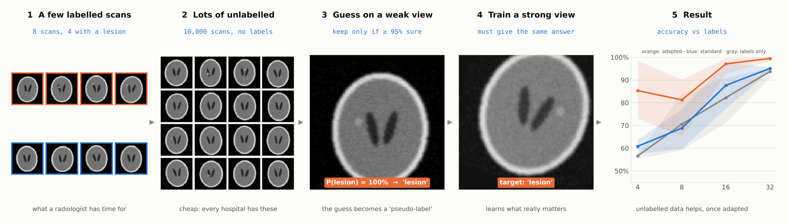
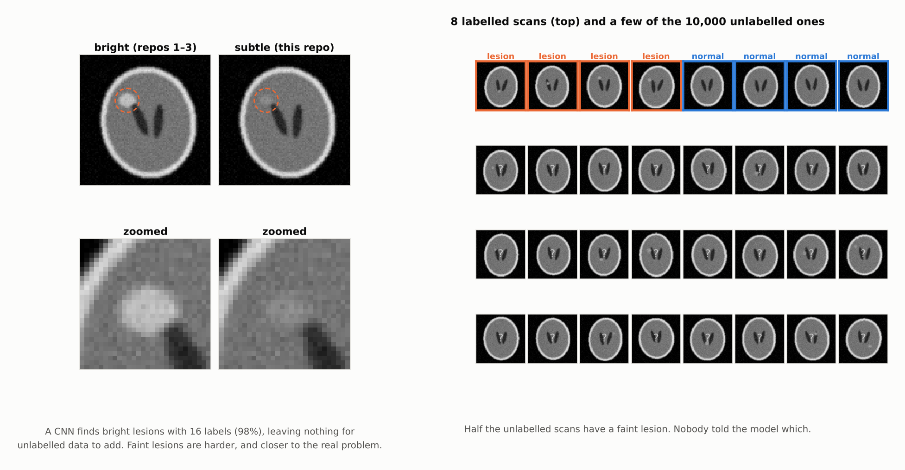
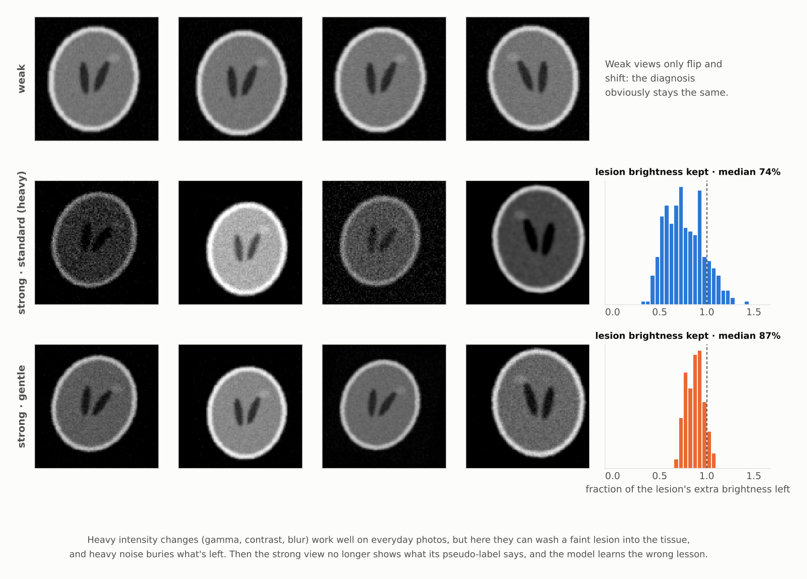
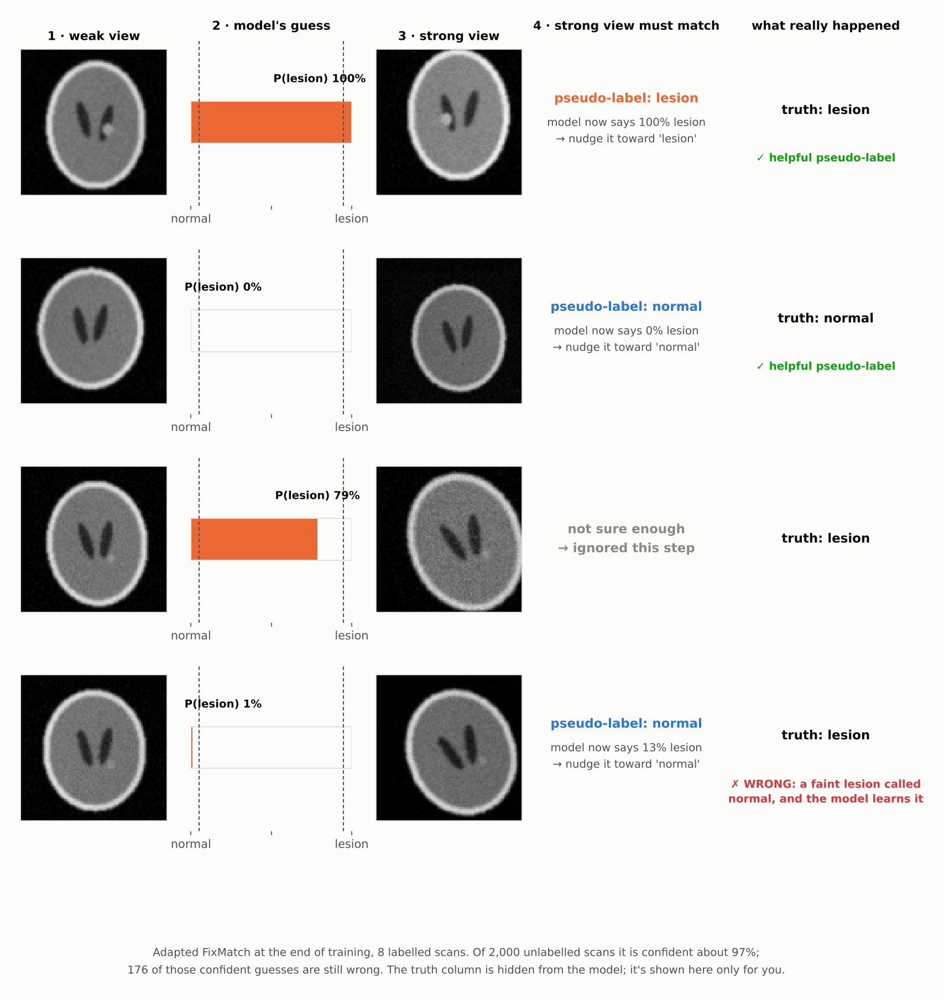
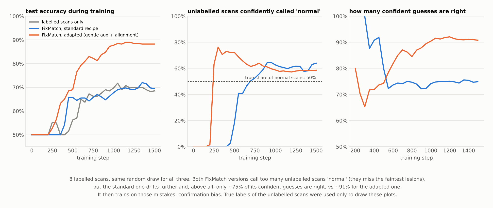
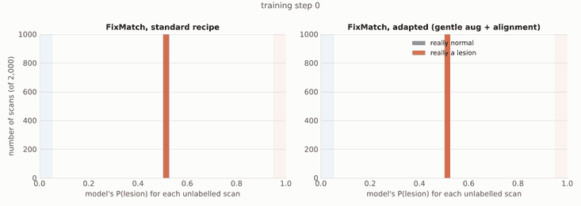
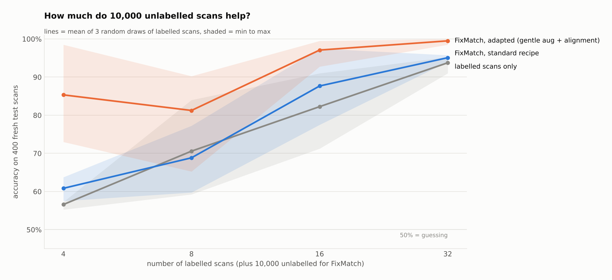

<h1 align="center">How semi-supervised learning works</h1>

<p align="center">
  <b>Train a lesion detector from 4 labelled brain-MRI-style scans plus 10,000 unlabelled ones,<br>
  see why the standard recipe fails on subtle lesions, and fix it.</b>
</p>

<p align="center">
  
  
  
  
</p>

<p align="center">
  
</p>

In hospitals, scans are plentiful but labels are scarce: each one costs a radiologist's time. **Semi-supervised
learning trains on both at once**: a handful of labelled scans plus a pile of unlabelled ones. This repo uses
**FixMatch** ([Sohn et al., 2020](https://arxiv.org/abs/2001.07685)), one of the simplest and strongest methods,
and shows step by step what happens inside it, including where it goes wrong.

Part 4 of a series that follows the **same synthetic brain slice** through different methods:

| | Repo | What it shows |
|:---:|---|---|
| 1 | [How a CNN works](https://github.com/anupbagale/cnn-one-image) | convolution, pooling, evidence maps |
| 2 | [How a ViT works](https://github.com/anupbagale/how-vit-works) | patches, self-attention, `[CLS]` |
| 3 | [How self-supervised learning works](https://github.com/anupbagale/how-self-supervised-learning-works) | learn from unlabelled scans first, labels later |
| **4** | **How semi-supervised learning works** (this repo) | **learn from labelled and unlabelled scans together** |

---

## 1 · The data: a few labels, many unlabelled scans



A small CNN finds the **bright** lesions from the earlier repos with just 16 labels (98% accuracy), leaving nothing
for unlabelled data to add. So this repo uses **subtle lesions**: the same positions, but faint and small. They're
harder to see, and closer to the findings that are actually easy to miss in real scans.

## 2 · The key ingredient: weak and strong views



FixMatch looks at every unlabelled scan twice:

- a **weak** view (flip, small shift), where the diagnosis obviously doesn't change;
- a **strong** view (rotation, zoom, contrast, brightness, noise…), which is much harder to recognise.

## 3 · One FixMatch step, by hand



For each unlabelled scan:

1. The model guesses on the **weak** view.
2. If it's at least **95% sure**, the guess becomes a **pseudo-label**. Otherwise the scan is skipped this step.
3. The model must give that same answer for the **strong** view.

```python
# semisup/fixmatch.py: the whole idea in five lines
probs        = model(weak(x_unlabelled)).softmax(1).detach()
conf, pseudo = probs.max(1)
mask         = (conf >= 0.95).float()                       # only confident guesses count
loss_u       = (cross_entropy(model(strong(x_unlabelled)), pseudo) * mask).mean()
loss         = loss_labelled + loss_u
```

The bottom row is the danger: a faint lesion, **confidently called normal**. The model now teaches itself a
mistake, and with this subtle data that kind of mistake is the common one.

## 4 · What went wrong with the standard recipe



With few labels, FixMatch drifts towards calling too many unlabelled scans **normal**: it misses the faintest
lesions, labels them "normal" with confidence, and then trains on those mistakes. This is called
**confirmation bias**. In the run above (8 labels), the standard recipe ends up calling 64% of scans normal (the truth
is 50%), and **only about 75% of its confident guesses are right**. The adapted recipe also over-calls normal
(58%), but **about 91% of its confident guesses are right**, and that difference shows up directly in test accuracy.

Two causes, and two well-known fixes:

| Problem | Fix used here |
|---|---|
| The **heavy** strong augmentation (big contrast and gamma changes, blur, lots of noise) can wash a faint lesion into the tissue (step 2's histograms). The strong view then shows "normal" while its pseudo-label says "lesion", and the model learns that faint spots don't matter. | **Gentle** strong augmentation: same geometry, much smaller intensity changes, less noise. |
| Nothing stops the guesses from drifting towards one class. | **Distribution alignment** ([ReMixMatch](https://arxiv.org/abs/1911.09785)): rescale the model's guesses so that, on average, they match the 50/50 class balance of the labelled scans. |

```python
# distribution alignment: a few lines in semisup/fixmatch.py
running_p = 0.99 * running_p + 0.01 * probs.mean(0)        # what the model usually guesses
probs     = probs * target_dist / running_p                # pull it back to the labelled balance
probs     = probs / probs.sum(1, keepdim=True)
```

## 5 · Watching the unlabelled scans separate

<p align="center">
  
</p>

Each frame shows the model's P(lesion) for 2,000 unlabelled scans, coloured by their true label (hidden from
the model). Watch the orange scans (real lesions): with the standard recipe, many more of them end up on the
"normal" side.

## 6 · Results



Accuracy on **400 fresh test scans**, mean of 3 random draws of the labelled scans (min to max in brackets):

| Labelled scans | Labelled only | FixMatch, standard | FixMatch, adapted |
|:---:|:---:|:---:|:---:|
| 4 | 57% (55–57) | 61% (58–64) | **85%** (73–99) |
| 8 | 71% (59–84) | 69% (60–77) | **81%** (65–90) |
| 16 | 82% (71–91) | 88% (78–98) | **97%** (93–100) |
| 32 | 94% (91–95) | 95% (94–96) | **99.5%** (99–100) |

And the quality of the pseudo-labels at the end of training (on 2,000 unlabelled scans):

| Labelled scans | Standard: share labelled · share correct | Adapted: share labelled · share correct |
|:---:|:---:|:---:|
| 4 | 95% · **63%** | 96% · **88%** |
| 8 | 91% · 72% | 95% · 84% |
| 16 | 88% · 92% | 98% · 98% |
| 32 | 92% · 98% | 99% · 99.6% |

What this shows:

- **Unlabelled data helps a lot, once the recipe fits the data.** With 16 labels, adapted FixMatch reaches 97%;
  using the labels alone needs about twice as many to reach 94%.
- **Off-the-shelf FixMatch helps only a little** (1–6 points), **and with 8 labels it's slightly worse** than using
  the labels alone. Its pseudo-labels are only 63–72% right with 4–8 labels, so it spends much of its training
  learning mistakes.
- **With very few labels, results swing a lot** depending on *which* scans got labelled (73–99% with 4 labels).
  Picking good scans to label is a research field of its own (*active learning*).

---

## Honest notes

- **No peeking at the final numbers.** The adapted recipe was developed while watching the usual test set
  (the one shared with the other repos). So every number above comes from a **fresh test set** that was never
  used during development.
- **Hyperparameters follow the FixMatch paper** (95% threshold, loss weight 1, SGD with cosine decay), except
  4 unlabelled scans per labelled one instead of 7, to keep it fast on a CPU.
- **Synthetic data.** Real scans add anatomy variation, scanner differences and class imbalance (most scans are
  normal), which makes distribution alignment trickier: you need to know or estimate the true balance.
- **Small CNN on purpose.** About 15,000 parameters, so every experiment runs on a laptop CPU.

## Run it yourself

```bash
git clone https://github.com/anupbagale/how-semi-supervised-learning-works.git
cd how-semi-supervised-learning-works
pip install torch --index-url https://download.pytorch.org/whl/cpu
pip install -r requirements.txt

python walkthrough.py        # ~1 min: redraws every figure from the saved results and weights
python -m pytest -q          # augmentation, EMA and FixMatch-loop tests

# optional: redo every experiment
python run_experiments.py    # ~1 hour on a laptop CPU
```

## Repository layout

```
how-semi-supervised-learning-works/
├── semisup/
│   ├── fixmatch.py        FixMatch training loop, distribution alignment, EMA
│   ├── augment.py         weak and strong (heavy / gentle) augmentations
│   ├── model.py           small CNN (~15k parameters)
│   └── phantom.py         synthetic slices, with a SUBTLE-lesion preset
├── run_experiments.py     every experiment behind the README
├── walkthrough.py         draws every figure
├── results/               CSV and NPZ files behind every number
├── weights/               trained models for the 8-label example
├── tests/test_semisup.py
└── assets/                figures and animation
```

## Further reading

- Sohn et al., [*FixMatch: Simplifying Semi-Supervised Learning with Consistency and Confidence*](https://arxiv.org/abs/2001.07685), 2020
- Berthelot et al., [*ReMixMatch: Semi-Supervised Learning with Distribution Alignment and Augmentation Anchoring*](https://arxiv.org/abs/1911.09785), 2019
- Arazo et al., [*Pseudo-Labeling and Confirmation Bias in Deep Semi-Supervised Learning*](https://arxiv.org/abs/1908.02983), 2019

## License

MIT, see [LICENSE](LICENSE).
